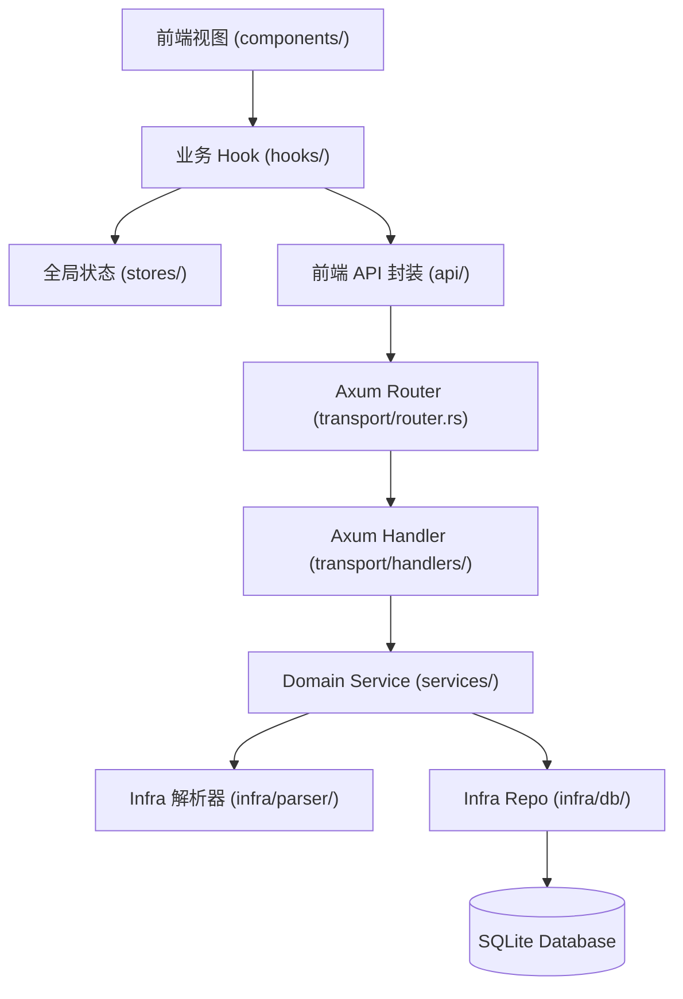

# LuminaRead (阅境) - 全局架构与代码功能速查索引 (CODEBASE_MAP)

> **AI 行动守则**：修改功能前**必须查阅本表**按图索骥，直接定位目标文件。严禁盲目进行全仓库无差别 `grep` 或遍历无关大文件。

---

## 1. 核心业务功能速查矩阵 (Feature Matrix)

| 业务功能模块 | 前端视图 / 组件 (UI) | 前端核心 Hook / 辅助函数 | 后端路由 (Axum) | 后端 Service / Infra | 数据持久化 / 缓存 |
|---|---|---|---|---|---|
| **全局多端导航外壳与路由分发** | [`App.tsx`](frontend/src/App.tsx) [`AppPageRouter.tsx`](frontend/src/app/components/AppPageRouter.tsx) [`DesktopHeader.tsx`](frontend/src/app/components/DesktopHeader.tsx) [`MobileAppBar.tsx`](frontend/src/app/components/MobileAppBar.tsx) [`MobileBottomNav.tsx`](frontend/src/app/components/MobileBottomNav.tsx) [`BottomSheet.tsx`](frontend/src/shared/ui/BottomSheet.tsx) | [`useAppNavSlice.ts`](frontend/src/app/hooks/useAppNavSlice.ts) [`useAppTtsSlice.ts`](frontend/src/app/hooks/useAppTtsSlice.ts) [`useAppActions.ts`](frontend/src/app/hooks/useAppActions.ts) [`listeningHelper.ts`](frontend/src/app/helpers/listeningHelper.ts) [`readerNavStore.ts`](frontend/src/stores/readerNavStore.ts) [`ttsStore.ts`](frontend/src/stores/ttsStore.ts) | - | - | URL SearchParams (`?page=&book=`) / LocalStorage |
| **书架与书籍管理** | [`frontend/src/features/bookshelf/components/`](frontend/src/features/bookshelf/components) | [`useBookOperations.ts`](frontend/src/features/bookshelf/hooks/useBookOperations.ts) [`bookshelfApi.ts`](frontend/src/features/bookshelf/api/bookshelfApi.ts) | `GET/PUT/DELETE /api/books/:id` `GET /api/books` | [`book_service/`](backend/src/services/book_service) (`mod.rs`, `content.rs`, `maintenance.rs`) [`book_repo.rs`](backend/src/infra/db/book_repo.rs) | SQLite `books` 表 [`schema.rs#L16`](backend/src/infra/db/schema.rs#L16) |
| **电子书上传解析** | [`frontend/src/components/Bookshelf/`](frontend/src/components/Bookshelf) | [`useBookOperations.ts`](frontend/src/features/bookshelf/hooks/useBookOperations.ts) | `POST /api/books/upload` `POST /api/books/upload/chunk` | [`upload_service.rs`](backend/src/services/upload_service.rs) [`infra/parser/`](backend/src/infra/parser) (epub, [`pdf/`](backend/src/infra/parser/pdf), mobi, txt) | `data/books/` `data/covers/` |
| **阅读器核心渲染与分页** | [`ReaderWorkspace.tsx`](frontend/src/features/reader/ReaderWorkspace.tsx) [`frontend/src/features/reader/components/`](frontend/src/features/reader/components) | [`useBookContent.ts`](frontend/src/features/reader/hooks/useBookContent.ts) [`useChapterStream.ts`](frontend/src/features/reader/hooks/useChapterStream.ts) [`usePaginationLayout.ts`](frontend/src/features/reader/hooks/usePaginationLayout.ts) [`useReaderGestures.ts`](frontend/src/features/reader/hooks/useReaderGestures.ts) | `GET /api/books/:id/content` `GET /api/books/:id/chapters/:index` | [`reader_service.rs`](backend/src/services/reader_service.rs) [`book_service/content.rs`](backend/src/services/book_service/content.rs) | 内存分页流 / 6 章滑窗流 / Web Worker |
| **PDF 页面光栅化与流式元数据** | [`PdfReader.tsx`](frontend/src/features/reader/components/PdfReader.tsx) [`PdfMobileReader.tsx`](frontend/src/features/reader/components/PdfMobileReader.tsx) | [`useBookContent.ts`](frontend/src/features/reader/hooks/useBookContent.ts) | `GET /api/books/:id/pdf/meta` `GET /api/books/:id/pdf/page/:num` | [`book_service/pdf.rs`](backend/src/services/book_service/pdf.rs) [`infra/parser/pdf/`](backend/src/infra/parser/pdf) (`mod.rs`, `meta.rs`) | `data/pdf_cache/` 双层单飞锁控制 |
| **阅读进度同步** | [`frontend/src/features/reader-controls/`](frontend/src/features/reader-controls) | [`useReadingProgressSync.ts`](frontend/src/features/reader/hooks/useReadingProgressSync.ts) | `PUT /api/books/:id/progress` | [`reader_service.rs`](backend/src/services/reader_service.rs) [`reader_repo.rs`](backend/src/infra/db/reader_repo.rs) | SQLite `reading_progress` [`schema.rs#L69`](backend/src/infra/db/schema.rs#L69) |
| **划线高亮与书签** | [`frontend/src/features/reader-sidebar/`](frontend/src/features/reader-sidebar) [`frontend/src/features/notes/components/`](frontend/src/features/notes/components) | [`useReaderHighlights.ts`](frontend/src/features/reader/hooks/useReaderHighlights.ts) [`useReaderBookmarks.ts`](frontend/src/features/reader/hooks/useReaderBookmarks.ts) [`useHighlightMutations.ts`](frontend/src/features/notes/hooks/useHighlightMutations.ts) | `GET/POST /api/books/:id/highlights` `GET/POST /api/books/:id/bookmarks` `PUT/DELETE /api/highlights/:id` | [`reader_service.rs`](backend/src/services/reader_service.rs) [`reader_repo.rs`](backend/src/infra/db/reader_repo.rs) | SQLite `highlights`, `bookmarks` [`schema.rs#L79`](backend/src/infra/db/schema.rs#L79) |
| **思维导图 (Mindmap)** | [`MindmapView.tsx`](frontend/src/features/reader-sidebar/components/MindmapView.tsx) [`MindmapFullscreenModal.tsx`](frontend/src/features/reader-sidebar/components/MindmapFullscreenModal.tsx) *(Lazy)* | 树状布局算法 | - | - | 客户端 SVG 实时渲染 |
| **Edge TTS 语音朗读** | [`frontend/src/features/audio-tts/components/`](frontend/src/features/audio-tts/components) [`MobileMusicPlayerView.tsx`](frontend/src/features/audio-tts/components/MobileMusicPlayerView.tsx) [`MobileTransportDeck.tsx`](frontend/src/features/audio-tts/components/MobileTransportDeck.tsx) [`TtsDrawersLayer.tsx`](frontend/src/features/audio-tts/components/TtsDrawersLayer.tsx) *(Lazy)* [`GlobalListeningCapsule.tsx`](frontend/src/app/components/GlobalListeningCapsule.tsx) | [`useTtsAudioCore.ts`](frontend/src/features/audio-tts/hooks/useTtsAudioCore.ts) [`useTtsAudioControls.ts`](frontend/src/features/audio-tts/hooks/useTtsAudioControls.ts) [`ttsAudioSession.ts`](frontend/src/features/audio-tts/helpers/ttsAudioSession.ts) [`ttsApi.ts`](frontend/src/features/audio-tts/api/ttsApi.ts) | `GET/POST /api/tts/speak` `GET /api/tts/voices` `GET /api/tts/audio/:hash` | [`tts_service/`](backend/src/services/tts_service) (`mod.rs`, `edge_client.rs`, `dialogue.rs`, `engine.rs`, `sanitizer.rs`, `voices.rs`) [`tts_handler.rs`](backend/src/transport/handlers/tts_handler.rs) | SQLite `tts_audio_cache` `data/tts_cache/` LRU Blob 缓存释放 |
| **AI 伴读 (苏格拉底 / 角色图谱)** | [`frontend/src/features/copilot/components/`](frontend/src/features/copilot/components) | [`useCopilotChat.ts`](frontend/src/features/copilot/hooks/useCopilotChat.ts) [`useCopilotRecap.ts`](frontend/src/features/copilot/hooks/useCopilotRecap.ts) | `POST /api/ai/copilot` `GET/POST /api/ai/conversations` `GET /api/ai/character-graph/:id` | [`ai_service/`](backend/src/services/ai_service) (`mod.rs`, `copilot_engine.rs`, `graph.rs`, `llm_client.rs`, `translator.rs`, `translation_engine.rs`, `recap.rs`) [`conv_repo.rs`](backend/src/infra/db/conv_repo.rs) | SQLite `ai_conversations` `ai_copilot_cache` |
| **全网搜书与下载** | [`frontend/src/features/discovery/components/`](frontend/src/features/discovery/components) | [`useBookSearch.ts`](frontend/src/features/discovery/hooks/useBookSearch.ts) [`useBookDownload.ts`](frontend/src/features/discovery/hooks/useBookDownload.ts) | `GET /api/discover/search` `POST /api/discover/download` `GET /api/discover/tasks` | [`discovery_service/`](backend/src/services/discovery_service) (`mod.rs`, `providers/`, `sanitizer.rs`, `builder.rs`, `downloader.rs`, `searcher.rs`, `network.rs`, `http_client.rs`) [`source_repo.rs`](backend/src/infra/db/source_repo.rs) | SQLite `book_sources`, `download_tasks` |
| **全文检索 (FTS5)** | [`frontend/src/features/search-stats/`](frontend/src/features/search-stats) [`SidebarDrawer.tsx`](frontend/src/features/reader-sidebar/SidebarDrawer.tsx) | [`useGlobalSearch.ts`](frontend/src/features/search-stats/hooks/useGlobalSearch.ts) [`useSidebarSearch.ts`](frontend/src/features/reader-sidebar/hooks/useSidebarSearch.ts) | `GET /api/search` `GET /api/books/:id/search` | [`search_repo.rs`](backend/src/infra/db/search_repo.rs) [`search_handler.rs`](backend/src/transport/handlers/search_handler.rs) | SQLite `book_fts` (trigram) `book_paragraphs` |
| **藏书馆分类划分** | [`frontend/src/features/bookshelf/`](frontend/src/features/bookshelf) | [`useLibraries.ts`](frontend/src/features/bookshelf/hooks/useLibraries.ts) | `GET/POST /api/libraries` `PUT/DELETE /api/libraries/:id` | [`library_service.rs`](backend/src/services/library_service.rs) [`library_repo.rs`](backend/src/infra/db/library_repo.rs) | SQLite `reading_libraries` |
| **阅读统计与系统清理** | [`frontend/src/features/search-stats/`](frontend/src/features/search-stats) | [`useReadingStats.ts`](frontend/src/features/search-stats/hooks/useReadingStats.ts) | `GET /api/stats/overview` `POST /api/stats/session` `POST /api/system/clear-cache` | [`book_service/maintenance.rs`](backend/src/services/book_service/maintenance.rs) [`stats_handler.rs`](backend/src/transport/handlers/stats_handler.rs) | SQLite `reading_sessions` |

---

## 2. 后端配置体系架构速查 (`backend/src/config/`)

系统配置已彻底解耦为高内聚子模块（单文件均 ≤ 260 行）：

| 配置文件 | 职责范围 |
|---|---|
| [`models.rs`](backend/src/config/models.rs) | `AppConfig` 结构体、嵌套配置字段（网络/代理/TTS/AI/路径）与默认值（`Default` 实现） |
| [`cli.rs`](backend/src/config/cli.rs) | 命令行启动参数解析 (`--port`, `--host`, `--data-dir` 等) 与终端 `--help` 打印 |
| [`parser.rs`](backend/src/config/parser.rs) | 轻量 TOML 行流解析器、标量类型转换与字符串反转义 |
| [`serializer.rs`](backend/src/config/serializer.rs) | TOML 格式化生成器与动态配置补丁合并器 (`patch_from_value`) |
| [`mod.rs`](backend/src/config/mod.rs) | 配置单例门面、三级优先级加载流程 (`CLI ➔ TOML ➔ Default`) 与自动化单元测试 |

---

## 3. 状态拓扑与持久化速查

### 全局状态 (Zustand Stores)
- [`readerNavStore.ts`](frontend/src/stores/readerNavStore.ts)：阅读器当前章节、滚动偏移、分页与目录树导航状态。
- [`ttsStore.ts`](frontend/src/stores/ttsStore.ts)：全局 TTS 播放器状态（播放/暂停、语速、音色、当前朗读段落索引）。
- [`typographyStore.ts`](frontend/src/stores/typographyStore.ts)：排版字体、字号、行距、边距、背景主题（日间/夜间/护眼/羊皮纸）。
- [`useBooksStore.ts`](frontend/src/shared/stores/useBooksStore.ts)：当前书架书籍列表、过滤条件与分类缓存。

### 核心数据库表 (SQLite: `data/luminaread.db`)
初始化见 [`backend/src/infra/db/schema.rs`](backend/src/infra/db/schema.rs)：
- `books`: 书籍元数据、解析状态、总阅读时长、章节 JSON、人物图谱 JSON。
- `book_paragraphs` & `book_fts`: 段落全文切割与 SQLite FTS5 trigram 倒排索引。
- `reading_progress`: 每本书最新阅读章节、滚动偏移量与百分比。
- `highlights`: 划线划词、评论笔记、高亮颜色与 CFI 范围。
- `bookmarks`: 章节书签快照。
- `book_sources` & `download_tasks`: OPDS / Z-Lib 外部书源与异步后台下载任务队列。
- `ai_conversations` & `ai_copilot_cache`: AI 对话记录、追问建议与回答缓存。
- `tts_audio_cache`: 神经语音合成 MP3 文件哈希与缓存命中计数。

---

## 4. 标准调用链路规范 (Data Flow Hierarchy)

排查与新增业务时，严格按照以下调用链路单向穿透，**严禁跨层越级依赖**（Handler 严禁内联 SQL 或系统子进程调用）：

---

## 5. AI 编码与工程守则（遵从 GEMINI.md）

1. **查表定位优先**：接到任何业务修改指令，必须先查阅本文件的 **第 1 节【业务功能速查矩阵】**，精准打开对应的 1~2 个具体模块，严禁全仓库无脑递归搜索。
2. **前端代码规范（React 19 / TypeScript）**：
   - **组件行数红线**：单组件文件禁止超过 **300 行**。
   - **函数/Hook 红线**：单函数或自定义 Hook 禁止超过 **80 行**。
   - **关注点分离**：数据清洗计算提取至 `helpers.ts` 纯函数；复杂副作用提取至 `hooks/`；重型 Modal/Drawer 默认使用 `React.lazy` + `Suspense` 按需分包。
3. **后端代码规范（Rust Axum / Tokio / SQLite）**：
   - **模块行数红线**：单 `.rs` 源码文件禁止超过 **400 行**（不含单元测试）。
   - **函数行数红线**：单函数或方法禁止超过 **80 行**。
   - **零 Panic 准则**：生产代码禁止 `.unwrap()` / `.expect()`；外部路径必须经过 `sanitize_path` 校验。
   - **流式 I/O 保护**：处理电子书解析（MOBI/TXT/PDF）时必须使用 `Read::take(MAX_BYTES)` 限流，杜绝无界 `read_to_end`。
