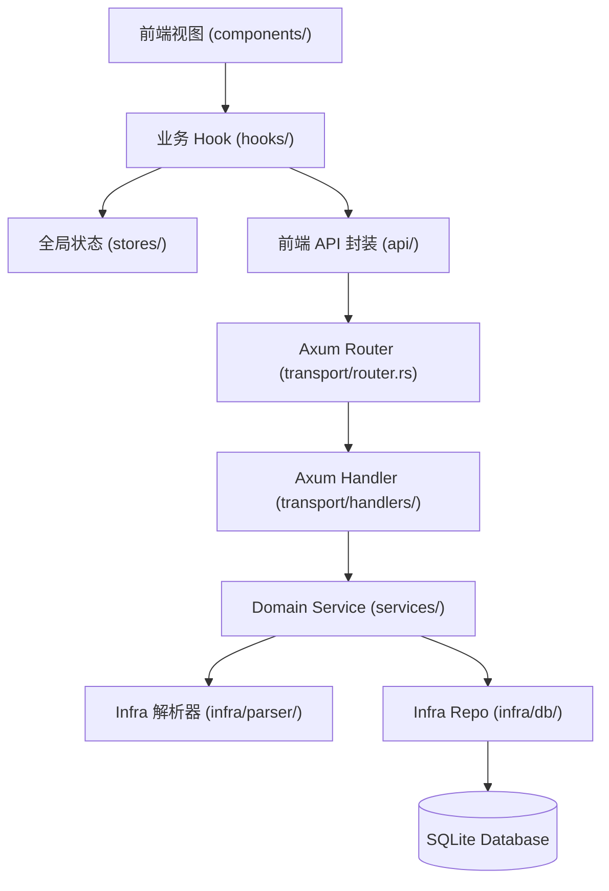

# LuminaRead (阅境) - 全局架构与代码功能速查索引 (CODEBASE_MAP)

> **AI 行动守则**：修改功能前**必须查阅本表**按图索骥，直接定位目标文件。严禁盲目进行全仓库无差别 `grep` 或遍历无关大文件。

---

## 1. 核心业务功能速查矩阵 (Feature Matrix)

| 业务功能模块 | 前端视图 / 组件 (UI) | 前端核心 Hook / API | 后端路由 (Axum) | 后端 Service / Infra | 数据持久化 / 缓存 |
|---|---|---|---|---|---|
| **书架与书籍管理** | [`frontend/src/features/bookshelf/components/`](frontend/src/features/bookshelf/components) | [`useBookOperations.ts`](frontend/src/features/bookshelf/hooks/useBookOperations.ts) [`bookshelfApi.ts`](frontend/src/features/bookshelf/api/bookshelfApi.ts) | `GET/PUT/DELETE /api/books/:id` `GET /api/books` | [`book_service.rs`](backend/src/services/book_service.rs) [`book_repo.rs`](backend/src/infra/db/book_repo.rs) | SQLite `books` 表 [`schema.rs#L16`](backend/src/infra/db/schema.rs#L16) |
| **电子书上传解析** | [`frontend/src/components/Bookshelf/`](frontend/src/components/Bookshelf) | [`useBookOperations.ts`](frontend/src/features/bookshelf/hooks/useBookOperations.ts) | `POST /api/books/upload` `POST /api/books/upload/chunk` | [`upload_service.rs`](backend/src/services/upload_service.rs) [`infra/parser/`](backend/src/infra/parser) (epub/pdf/mobi/txt) | `data/books/` `data/covers/` |
| **阅读器核心渲染** | [`ReaderWorkspace.tsx`](frontend/src/features/reader/ReaderWorkspace.tsx) [`frontend/src/features/reader/components/`](frontend/src/features/reader/components) | [`useBookContent.ts`](frontend/src/features/reader/hooks/useBookContent.ts) [`useChapterStream.ts`](frontend/src/features/reader/hooks/useChapterStream.ts) [`usePaginationLayout.ts`](frontend/src/features/reader/hooks/usePaginationLayout.ts) | `GET /api/books/:id/content` `GET /api/books/:id/chapters/:index` | [`reader_service.rs`](backend/src/services/reader_service.rs) | 内存分页流 / Web Worker 切片 |
| **阅读进度同步** | [`frontend/src/features/reader-controls/`](frontend/src/features/reader-controls) | [`useReadingProgressSync.ts`](frontend/src/features/reader/hooks/useReadingProgressSync.ts) | `PUT /api/books/:id/progress` | [`reader_service.rs`](backend/src/services/reader_service.rs) [`reader_repo.rs`](backend/src/infra/db/reader_repo.rs) | SQLite `reading_progress` [`schema.rs#L69`](backend/src/infra/db/schema.rs#L69) |
| **划线高亮与书签** | [`frontend/src/features/reader-sidebar/`](frontend/src/features/reader-sidebar) [`frontend/src/features/notes/components/`](frontend/src/features/notes/components) | [`useReaderHighlights.ts`](frontend/src/features/reader/hooks/useReaderHighlights.ts) [`useReaderBookmarks.ts`](frontend/src/features/reader/hooks/useReaderBookmarks.ts) [`useHighlightMutations.ts`](frontend/src/features/notes/hooks/useHighlightMutations.ts) | `GET/POST /api/books/:id/highlights` `GET/POST /api/books/:id/bookmarks` `PUT/DELETE /api/highlights/:id` | [`reader_service.rs`](backend/src/services/reader_service.rs) [`reader_repo.rs`](backend/src/infra/db/reader_repo.rs) | SQLite `highlights`, `bookmarks` [`schema.rs#L79`](backend/src/infra/db/schema.rs#L79) |
| **Edge TTS 语音朗读** | [`frontend/src/features/audio-tts/components/`](frontend/src/features/audio-tts/components) [`GlobalListeningCapsule.tsx`](frontend/src/app/components/GlobalListeningCapsule.tsx) | [`useTtsAudioCore.ts`](frontend/src/features/audio-tts/hooks/useTtsAudioCore.ts) [`useTtsAudioControls.ts`](frontend/src/features/audio-tts/hooks/useTtsAudioControls.ts) [`ttsApi.ts`](frontend/src/features/audio-tts/api/ttsApi.ts) | `GET/POST /api/tts/speak` `GET /api/tts/voices` `GET /api/tts/audio/:hash` | [`tts_service.rs`](backend/src/services/tts_service.rs) [`tts_handler.rs`](backend/src/transport/handlers/tts_handler.rs) | SQLite `tts_audio_cache` `data/tts_cache/` |
| **AI 伴读 (苏格拉底)** | [`frontend/src/features/copilot/components/`](frontend/src/features/copilot/components) | [`useCopilotChat.ts`](frontend/src/features/copilot/hooks/useCopilotChat.ts) [`useCopilotRecap.ts`](frontend/src/features/copilot/hooks/useCopilotRecap.ts) | `POST /api/ai/copilot` `GET/POST /api/ai/conversations` | [`ai_service.rs`](backend/src/services/ai_service.rs) [`conv_repo.rs`](backend/src/infra/db/conv_repo.rs) | SQLite `ai_conversations` `ai_copilot_cache` |
| **全网搜书与下载** | [`frontend/src/features/discovery/components/`](frontend/src/features/discovery/components) | [`useBookSearch.ts`](frontend/src/features/discovery/hooks/useBookSearch.ts) [`useBookDownload.ts`](frontend/src/features/discovery/hooks/useBookDownload.ts) | `GET /api/discover/search` `POST /api/discover/download` `GET /api/discover/tasks` | [`discovery_service.rs`](backend/src/services/discovery_service.rs) [`source_repo.rs`](backend/src/infra/db/source_repo.rs) | SQLite `book_sources`, `download_tasks` |
| **全文检索 (FTS5)** | [`frontend/src/features/search-stats/`](frontend/src/features/search-stats) [`SidebarDrawer.tsx`](frontend/src/features/reader-sidebar/SidebarDrawer.tsx) | [`useGlobalSearch.ts`](frontend/src/features/search-stats/hooks/useGlobalSearch.ts) [`useSidebarSearch.ts`](frontend/src/features/reader-sidebar/hooks/useSidebarSearch.ts) | `GET /api/search` `GET /api/books/:id/search` | [`search_repo.rs`](backend/src/infra/db/search_repo.rs) [`search_handler.rs`](backend/src/transport/handlers/search_handler.rs) | SQLite `book_fts` (trigram) `book_paragraphs` |
| **藏书馆分类划分** | [`frontend/src/features/bookshelf/`](frontend/src/features/bookshelf) | [`useLibraries.ts`](frontend/src/features/bookshelf/hooks/useLibraries.ts) | `GET/POST /api/libraries` `PUT/DELETE /api/libraries/:id` | [`library_service.rs`](backend/src/services/library_service.rs) [`library_repo.rs`](backend/src/infra/db/library_repo.rs) | SQLite `reading_libraries` |
| **阅读统计与热力** | [`frontend/src/features/search-stats/`](frontend/src/features/search-stats) | [`useReadingStats.ts`](frontend/src/features/search-stats/hooks/useReadingStats.ts) | `GET /api/stats/overview` `POST /api/stats/session` | [`stats_handler.rs`](backend/src/transport/handlers/stats_handler.rs) | SQLite `reading_sessions` |

---

## 2. 状态拓扑与持久化速查

### 全局状态 (Zustand Stores)
- [`readerNavStore.ts`](frontend/src/stores/readerNavStore.ts)：阅读器当前章节、滚动偏移、分页与目录树导航状态。
- [`ttsStore.ts`](frontend/src/stores/ttsStore.ts)：全局 TTS 播放器状态（播放/暂停、语速、音色、当前朗读段落索引）。
- [`typographyStore.ts`](frontend/src/stores/typographyStore.ts)：排版字体、字号、行距、边距、背景主题（日间/夜间/护眼/羊皮纸）。
- [`useBooksStore.ts`](frontend/src/shared/stores/useBooksStore.ts)：当前书架书籍列表、过滤条件与分类缓存。

### 核心数据库表 (SQLite: `data/luminaread.db`)
初始化见 [`backend/src/infra/db/schema.rs`](backend/src/infra/db/schema.rs)：
- `books`: 书籍元数据、解析状态、总阅读时长、章节 JSON、人物图谱 JSON。
- `book_paragraphs` & `book_fts`: 段落全文切割与 SQLite FTS5 trigram 倒排索引。
- `reading_progress`: 每本书最新阅读章节、滚动偏移量与百分比。
- `highlights`: 划线划词、评论笔记、高亮颜色与 CFI 范围。
- `bookmarks`: 章节书签快照。
- `book_sources` & `download_tasks`: OPDS / Z-Lib 外部书源与异步后台下载任务队列。
- `ai_conversations` & `ai_copilot_cache`: AI 对话记录、追问建议与回答缓存。
- `tts_audio_cache`: 神经语音合成 MP3 文件哈希与缓存命中计数。

---

## 3. 标准调用链路规范 (Data Flow Hierarchy)

排查与新增业务时，严格按照以下调用链路单向穿透，严禁跨层越级依赖：

---

## 4. AI 编码与检索守则

1. **查表定位**：接到任何业务修改指令，必须先查阅本文件的 **第 1 节【业务功能速查矩阵】**，精准打开对应的 1~2 个具体文件。
2. **严禁全量 Grep**：严禁在未缩小范围前直接发起大范围 `grep_search`。
3. **架构规范**：编写或重构前端组件必须满足 [`GEMINI.md`](GEMINI.md)（组件 < 300 行，函数/Hook < 80 行，强拆 separation of concerns）。
