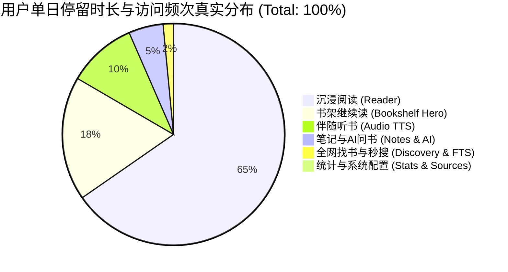
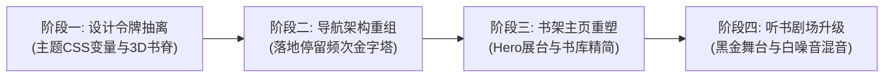

# 《阅境 (LuminaRead)》前端重构技术架构与性能规范

> **版本**：v2.0 (2026 现代化重构规范)  
> **适用范围**：Web 宽屏桌面端 (1440px+)、移动触屏端 (393px iPhone / Android)、Capacitor 原生打包壳  
> **设计基准**：对齐 Apple Books、Readwise Reader 与微信读书的高性能出版物标准  
> **编码铁律**：无条件遵循根目录下 [`GEMINI.md`](GEMINI.md)（单组件 < 300 行，Hook < 80 行，严格关注点分离）

---

## 目录索引 (Index)

1. [技术架构选型与评估矩阵 (Architecture Stack Matrix)](#一技术架构选型与评估矩阵)
2. [阅读器场景三大性能死穴与工程解法 (Performance Core Pillars)](#二阅读器场景三大性能死穴与工程解法)
3. [基于“停留时长与频次金字塔”的信息架构 (Retention Hierarchy)](#三基于停留时长与频次金字塔的信息架构)
4. [模块目录拓扑与防巨石代码边界 (Anti-Monolith Architecture)](#四模块目录拓扑与防巨石代码边界)
5. [设计令牌系统与无重绘主题换肤 (Design Tokens & Theming)](#五设计令牌系统与无重绘主题换肤)
6. [演进式落地重构路线图 (Implementation Roadmap)](#六演进式落地重构路线图)

---

## 一、 技术架构选型与评估矩阵

针对数字阅读类应用高文本密度、高频音频时间戳同步、多端（桌面宽屏+手机触屏）响应式交互的特征，本规范确立以下核心技术栈：

| 架构层级 | 选定方案 | 替代方案对比 | 决策考量与性能收益 |
|---|---|---|---|
| **构建与核心框架** | **Vite + React 19 + TypeScript** | Svelte 5 / SolidJS / Vue 3 | **生产力与资产继承最优**。现有项目中 70% 的核心基础设施（`workers/` 切片、`api/` 客户端、`utils/bookCache.ts`）可 **100% 平滑复用**，迁移风险为 0；React 19 编译器可自动推导细粒度记忆化（Memoization），消除无谓 VDOM 开销。 |
| **全局与局部状态** | **Zustand (切片隔离) + Primitive Selectors** | Redux Toolkit / Context API / MobX | **规避全页级联渲染的核心杀手锏**。彻底摒弃单一大 Store，拆分为 4 个高度隔离的切片；高频音频播放毫秒级时间戳更新时，仅触发单行文字的高亮突变，主页和阅读器 0 次重渲。 |
| **样式与视觉引擎** | **Tailwind CSS v4 + 原生 CSS 变量令牌** | CSS-in-JS (Emotion) / CSS Modules | **零运行时开销 (Zero-Runtime)**。样式静态抽取，五大纸张主题与排版变量全部绑定为原生 CSS 变量，切换主题耗时 `<1ms`，触发 GPU 直接合成，零 JS 重排损耗。 |
| **排版与长文本渲染** | **Web Worker 离线分页 + 虚拟视口窗口化 (Windowing)** | Canvas 纯手绘 / 浏览器直接排版 | **杜绝百页长文导致 DOM 树膨胀**。排版断词、行高换算、CJK 避头尾规则全部在已有的 `paginationWorker.ts` 计算；主线程 DOM 树永远只保留当前屏可见的 10~15 个段落节点。 |
| **跨端容器方案** | **响应式 SPA + Capacitor / Android 原生混编** | Flutter / React Native / Tauri v2 | **单套代码库覆盖全平台**。直接对接现存的 `android/` 目录，支持移动端透明沉浸状态栏、原生触觉振动反馈（Haptics）与离线 SQLite 桥接。 |

---

## 二、 阅读器场景三大性能死穴与工程解法

### 1. 伴随听书 (TTS) 高频进度同步导致整页卡顿
- **性能病灶**：Edge TTS 朗读时，底层音频播放器每秒派发数十次 `timeupdate` 与 `currentParagraphId` 事件。如果使用全局宽泛 Context 广播，会导致书架列表、顶部导航栏、排版工作台整页连带 Re-render，导致发热、掉帧。
- **工程解法**：采用 **Zustand Primitive Selector 细粒度局部订阅**：
  ```tsx
  // 规范：仅在高亮单句组件内部订阅自身布尔值，外部父组件完全静默
  export const ReadingSentence: React.FC<{ sentenceId: string; text: string }> = React.memo(({ sentenceId, text }) => {
    const isPlaying = useTtsStore(
      useCallback((s) => s.audioStatus.playing && s.currentSentenceId === sentenceId, [sentenceId])
    );
    return (
      <span className={isPlaying ? "bg-amber-400/30 text-amber-900 font-bold px-1 rounded transition-colors" : ""}>
        {text}
      </span>
    );
  });
  ```

### 2. 百万字巨著加载引发页面重排 (Reflow) 卡死
- **性能病灶**：一次性将几十万字章节或整本书插入 DOM，导致浏览器样式重算（Recalculate Style）与重排耗时突破 1000ms 以上，移动端低端芯片直接白屏或崩溃。
- **工程解法**：**双缓冲 Offscreen 预排版 + 虚拟视口复用**：
  ```
  [原始 EPUB/TXT 文本] ──▶ [Web Worker 后台离线管道 (paginationWorker.ts)]
                                  │ (计算断行、标点禁则、每页容纳字符)
                                  ▼
                         [扁平化页面索引缓冲池 PageIndexes[]]
                                  │
                                  ▼
             [当前视口 DOM (严格固定仅挂载 2~4 个页面容器)]
  ```

### 3. 主题换肤与字体大小调节瞬时掉帧
- **性能病灶**：调整字体或切换纸张主题时，若用 React State 遍历刷新数千个段落的内联样式，产生明显的顿挫感。
- **工程解法**：**CSS 变量级联透传 (CSS Variable Cascading)**：
  在阅读器最外层根容器绑定 CSS 变量，换肤只需修改容器上的 `data-theme` 属性：
  ```css
  .reader-workspace[data-theme="sepia"] {
    --bg-paper: #FBF0D9;
    --text-ink: #2D2319;
    --border-soft: rgba(120, 53, 15, 0.1);
    --color-highlight: rgba(245, 158, 11, 0.3);
  }
  ```
  该操作耗时小于 1ms，直接走 GPU 纹理合成，达到 120fps 丝滑响应。

---

## 三、 基于“停留时长与频次金字塔”的信息架构

根据数字阅读核心数据，用户的注意力与单日停留时长呈现高度倾斜分布。重构后的信息架构严格按照停留权重重构空间与导航通道：



### 1. 四级停留频次架构划分规范

| 频次层级 | 涉及功能模块 | 空间占比与布局定位 | 交互机制 |
|---|---|---|---|
| **Tier 1 (核心主场 83%)** | **沉浸阅读器** + **书架继续读** | 空间绝对倾斜。书架首屏 **70% 黄金区域** 赋予【正在阅读 Hero 展台】。 | 打开 App 直视上次阅读书籍，一键直达阅读器。 |
| **Tier 2 (伴随高停留 10%)** | **听书与音频中心 (TTS)** | 顶栏/底栏常驻灵动岛，跨页面全局悬浮触手可及。 | 播放时动态呼吸声波指示，随时一键收放或展开全屏黑金剧场。 |
| **Tier 3 (任务型快查 5%)** | **笔记·知识库** + **全文秒搜** | 顶栏二级核心 Tab；全局搜索采用快捷键 `⌘K` 瞬时呼出居中浮层。 | 搜完即走、查完即收，不占用常驻首屏空间。 |
| **Tier 4 (超低频设置 <2%)** | **全网找书** + **阅读统计** + **书源配置** | **从一级导航彻底剥离**，归入右上角/移动端【我的·设置与个人中心】抽屉。 | 偶发使用时不干扰核心心流，彻底释放导航带宽。 |

---

## 四、 模块目录拓扑与防巨石代码边界

严格遵循根目录下 [`GEMINI.md`](GEMINI.md) 规范：**任何组件单文件禁止超过 300 行代码；任何函数/Hook 禁止超过 80 行代码**。

```
frontend/src/
├── app/                           # 应用外壳与顶层骨架 (Application Shell)
│   ├── components/
│   │   ├── DesktopHeader.tsx      # 双层式电脑端顶栏 (Top Row + Page Ribbon, <200行)
│   │   ├── MobileBottomNav.tsx    # 移动端 3+1 黄金底栏 (<120行)
│   │   └── GlobalAudioCapsule.tsx # 全局浮动听书胶囊 (<150行)
│   └── App.tsx                    # 顶层路由调度器 (仅负责 React.lazy 分发)
│
├── features/                      # 业务领域垂直切分 (Feature-Driven Modules)
│   ├── bookshelf/                 # 书架领域
│   │   ├── components/            # Hero展台、书库分类、3D书网格 (各子组件 <200行)
│   │   ├── hooks/                 # useBookOperations.ts, useLibraries.ts (<80行)
│   │   ├── helpers.ts             # 纯计算排序、格式化纯函数
│   │   ├── constants.ts           # 静态枚举与默认参数
│   │   └── types.ts               # 业务契约类型
│   ├── reader/                    # 沉浸式阅读器领域
│   │   ├── components/            # 双页对开画布、页码标尺、选词悬浮气泡
│   │   ├── hooks/                 # usePaginationLayout.ts, useChapterStream.ts
│   │   └── ReaderWorkspace.tsx    # 纯骨架装配器 (<250行)
│   ├── audio-tts/                 # 听书与声学大剧场
│   │   ├── components/            # 黑金封面舞台、卡拉OK同步段落流、白噪音混音台
│   │   └── hooks/                 # useTtsAudioCore.ts, useAmbientMixer.ts
│   ├── typography/                # 排版调色工作台
│   ├── copilot/                   # 苏格拉底式 AI 伴读副屏
│   ├── notes/                     # 笔记与知识沉淀库
│   ├── discovery/                 # 全网找书与聚合下载引擎
│   └── search-stats/              # 全局 FTS5 搜索与 365 天阅读热力图
│
├── shared/                        # 跨领域公共基础设施
│   ├── stores/                    # Zustand 细粒度状态切片
│   │   ├── readerNavStore.ts      # 阅读章节与翻页状态
│   │   ├── ttsStore.ts            # 音频核心状态
│   │   ├── typographyStore.ts     # 排版偏好状态 (自动持久化)
│   │   └── useBooksStore.ts       # 书架书籍元数据
│   ├── design-tokens/             # 全局主题变量、字体集与阴影标准
│   ├── ui/                        # 无状态 UI 原子基础库 (Button, Slider, Drawer, Modal)
│   └── api/                       # Axum 后端 API 封装
│
└── workers/                       # Web Worker 后台计算线程 (离线切片与断行)
    ├── paginationWorker.ts
    └── punctuationHelpers.ts
```

---

## 五、 设计令牌系统与无重绘主题换肤 (Design Tokens)

统一采用 5 大经典印刷级阅读色系，全部以 CSS Custom Properties 形式落盘：

```css
:root {
  /* 品牌主色系 */
  --brand-primary: #1B88EE;
  --brand-hover: #136EC2;
  
  /* 3D 书脊立体光影令牌 */
  --shadow-book-spine: 0 10px 25px -5px rgba(0, 0, 0, 0.15), 0 8px 10px -6px rgba(0, 0, 0, 0.1);
  --shadow-book-hover: 0 20px 35px -5px rgba(27, 136, 238, 0.25), 0 10px 15px -5px rgba(0, 0, 0, 0.1);
}

/* 1. 纸白主题 (现代通透) */
[data-theme="white"] {
  --bg-paper: #FFFFFF;
  --text-ink: #1E293B;
  --border-subtle: rgba(226, 232, 240, 0.8);
}

/* 2. 羊皮纸主题 (温润长读) */
[data-theme="sepia"] {
  --bg-paper: #FBF0D9;
  --text-ink: #2D2319;
  --border-subtle: rgba(120, 53, 15, 0.12);
}

/* 3. 豆沙绿主题 (专业防蓝光护眼) */
[data-theme="green"] {
  --bg-paper: #CCE8CF;
  --text-ink: #1A3322;
  --border-subtle: rgba(6, 78, 59, 0.15);
}

/* 4. 深空灰主题 (夜间微光防眩) */
[data-theme="dark"] {
  --bg-paper: #1E1E24;
  --text-ink: #E2E8F0;
  --border-subtle: rgba(255, 255, 255, 0.1);
}

/* 5. 极黑主题 (OLED 像素关断省电) */
[data-theme="oled"] {
  --bg-paper: #0A0A0C;
  --text-ink: #94A3B8;
  --border-subtle: rgba(255, 255, 255, 0.08);
}
```

---

## 六、 演进式落地重构路线图 (Implementation Roadmap)

本方案支持**无痛渐进演进**，无需全量推倒重来，分为四个清晰里程碑：



1. **里程碑 1：设计令牌与样式基础设施抽离 (1~2天)**
   - 建立 `shared/design-tokens/`，将 5 款纸张主题与 6 款字形写入全局 CSS；
   - 提取 3D 书脊（`book-cover-3d`）微阴影与装订线动效公共 Class。
2. **里程碑 2：外壳与导航系统重构 (2~3天)**
   - 电脑端：实现双层式专业控制台，顶栏收缩为【书架】+【笔记】+【听书灵动岛】，右侧集成【个人与设置中心】抽屉；
   - 移动端：落盘 3+1 黄金底栏与常驻吸附的【听书悬浮胶囊】。
3. **里程碑 3：书架领域 (Bookshelf) 界面重构 (3~4天)**
   - 落地首屏 70% 权重的【正在阅读 Hero 展台】；
   - 消灭四层生硬过滤标签，重构为单排优雅的一级书库滑块与精致卡片流。
4. **里程碑 4：听书与音频中心 (Audio TTS) 沉浸大剧场 (2~3天)**
   - 接入黑金声学剧场（左侧立体黑胶与白噪音混音台，右侧卡拉OK段落高亮跟读流）；
   - 保证毫秒级播放时间戳更新与页面其他组件 100% 渲染隔离。
