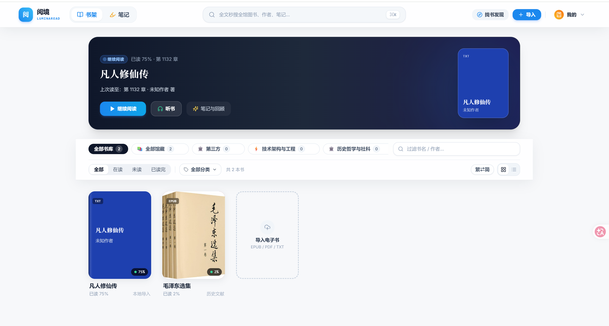
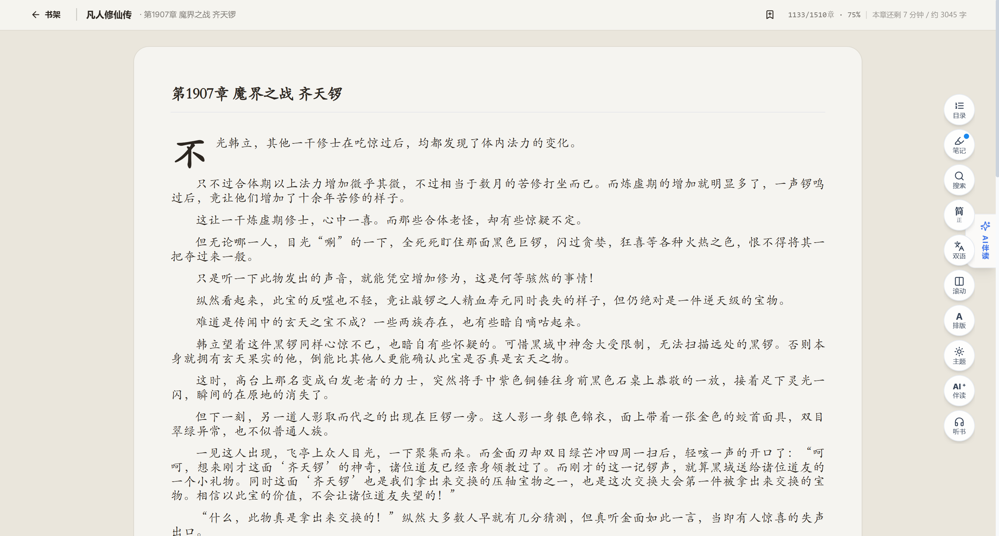
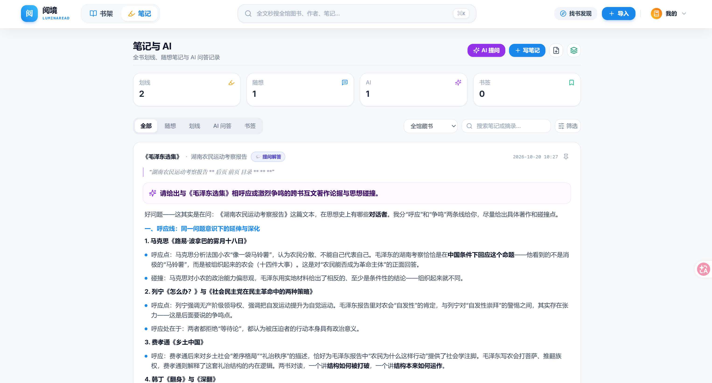
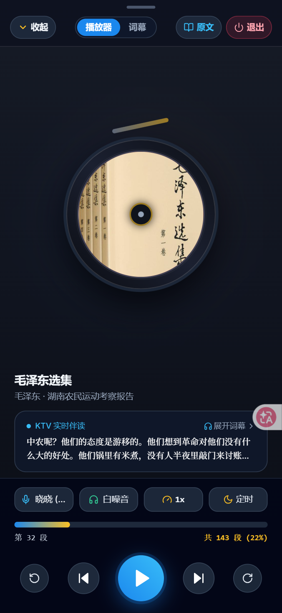

# LuminaRead (阅境)

**单文件部署的本地多端 Web 读书系统。** 前端静态资源与 SQLite 引擎全量内嵌进一个零依赖的 Rust 可执行文件，扔到任何机器上即可获得开箱即用的完整阅读体验。


<p align="center">
  
</p>

---

## 界面概览 (Visual Showcase)

### 🖥️ 桌面端·沉浸书架与出版级阅读体验

<p align="center">
  
</p>

* **出版级排版引擎**：仿生宣纸与羊皮纸质感、正文字形微调、首字下沉设计、章末预估时长与全能浮动阅读胶囊。
* **双模伴读**：随时呼出 AI 深度苏格拉底式伴读对话或切换至 Edge Neural TTS 听书模式，沉浸不被打断。

<p align="center">
  
</p>

* **AI 跨书智库工作台**：全书库划线、批注与书签集中汇聚，支持全文与跨书互文考据；深度接入大模型智能对谈与思想梳理。

---

### 📱 移动端·极致随身阅读与黑金听书剧场

针对手机与平板竖屏进行深度人机工效学重构，专为拇指热区与随行听读优化：

<table align="center" style="margin: 0 auto; text-align: center;">
  <tr>
    <td align="center" valign="top" width="33.3%">
      
      <br />
      <b>📱 移动端自适应书架</b>
      <p><i>单手拇指热区布局 · 极简双列书架 · 横向滑动分类 · 快捷居中听书入口</i></p>
    </td>
    <td align="center" valign="top" width="33.3%">
      
      <br />
      <b>🎧 黑金流光听书剧场</b>
      <p><i>黑胶唱片视觉动效 · KTV 逐字流光字幕 · 自然多音色演播 · 白噪音环境混音</i></p>
    </td>
    <td align="center" valign="top" width="33.3%">
      
      <br />
      <b>🎨 出版排版与调色抽屉</b>
      <p><i>出版级楷宋字体切换 · 6大仿生纸质主题（宣纸/羊皮纸/豆沙绿/墨水屏）</i></p>
    </td>
  </tr>
</table>

---

## 功能特性

**书城与书库**

- 全网搜书一键入库：Z-Library / 安娜的档案 / Project Gutenberg / OpenLibrary / Internet Archive / Wikisource / LibGen，以及 Calibre、Standard Ebooks 等 OPDS 书源
- 本地导入：EPUB / PDF / TXT / MOBI / AZW3 原生解析，自动提取封面与插图
- 藏书馆分类管理、每日回顾推荐

**阅读器**

- 单页 / 双页对翻 / 连续滚动三种排版，纸质纹理与日间 / 夜间 / 护眼主题
- 多字体排版（宋 / 楷 / 黑 / 仿宋 / 等宽）、首行缩进、字号行距细调
- 简体 / 繁体一键互换，跨繁简全文搜索
- 划线高亮、书签、笔记批注、脚注预览、引文卡片海报
- 双语对照阅读与英文划词翻译
- 阅读进度多端同步、阅读时长统计与热力图

**智能与语音**

- AI 苏格拉底伴读：引导式提问、章节回顾、对话知识图谱
- Edge Neural TTS 真人朗读：多音色、语速调节、睡眠定时、段落间无缝续播

**工程与部署**

- 全文检索基于 SQLite FTS5（trigram 分词），毫秒级跨书搜索
- 生产构建产物为单一可执行文件：前端 Gzip-9 预压缩内嵌，SQLite + Rustls 静态链接，零外部运行时依赖
- PWA 支持，桌面浏览器 / 手机浏览器 / Android 壳应用多端可用

## 快速开始

从 [Releases](../../releases) 下载对应平台的压缩包并解压，然后：

```bash
./luminaread -c config.toml
```

打开 `http://localhost:3456` 即可使用。数据默认落在 `./data` 目录，可通过 `data_dir` 配置或 `--data-dir` 参数自定义。

**Android**：在 Releases 下载 `luminaread_x.x.x_android.apk` 安装。应用内置 ARM64 原生内核可完全离线运行，也可在设置中填入局域网内服务端地址作为客户端模式。

## 从源码构建

前后端技术栈完全解耦（前端归 Node/npm，后端归 Rust/Cargo）。

### 前端（React 19 + Vite）

```bash
cd frontend
npm install        # 安装依赖
npm run dev        # 开发热重载 (端口 5173，自动反代后端 3456)
npm run build      # 生产构建，输出至 frontend/dist
```

### 后端（Rust + Axum）

```bash
cd backend
cargo run          # 本地启动 (端口 3456)
cargo test         # 运行单元测试
```

### 一键构建单文件生产程序

```bash
# Linux / macOS / WSL（前端打包 → 静态资源内嵌 → 静态链接）
make build

# Windows PowerShell
.\build.ps1
```

> `make build-backend` 默认使用系统工具链做静态链接。如需交叉编译，可通过 `make build-backend TOOLCHAIN=<工具链前缀>` 覆盖。

## 部署为系统服务（Linux + systemd）

```bash
chmod +x ./service.sh
./service.sh install     # 注册 systemd 常驻服务（开机自启 + 异常自动拉起）

./service.sh status      # 查看运行状态
./service.sh restart     # 重启服务
./service.sh stop        # 停止服务
./service.sh logs 100    # 查看最近 100 行日志
```

路径、运行用户、端口均可通过环境变量覆盖：`APP_DIR` / `DATA_DIR` / `RUN_USER` / `RUN_GROUP` / `PORT`。

## 配置说明

核心配置集中在 [config.toml](config.toml)：

| 配置项 | 说明 | 默认值 |
|---|---|---|
| `server.host` / `server.port` | 监听地址与端口 | `0.0.0.0:3456` |
| `server.api_base_url` | 前后端分离时的后端基准 URL，同源留空 | 空 |
| `storage.data_dir` | 数据存储根目录 | `./data` |
| `storage.db_path` | SQLite 数据库路径 | `<data_dir>/luminaread.db` |
| `network.proxy_url` | 外部请求代理（翻译 / 书源检索），无需则留空 | 空 |
| `server.max_upload_mb` | 单次上传体积上限 | `100` |
| `endpoints.*` | 翻译 / TTS / 书源检索接口，均可覆盖 | 内置默认 |

数据目录结构：

```text
data/
├── luminaread.db    # SQLite 主数据库（书架、章节、FTS 索引、笔记、进度与统计）
├── books/           # 原始电子书文件
├── covers/          # 自动提取的封面
├── pdf_cache/       # PDF 页面渲染缓存
└── tts_cache/       # TTS 音频缓存
```

## 项目结构

```text
├── frontend/               # 前端工程 (React 19 + TypeScript + Vite + TailwindCSS)
│   ├── src/
│   │   ├── features/       # 按业务域垂直切分的特性模块
│   │   ├── shared/         # 跨模块共享的 API 客户端、类型与 UI 基础件
│   │   └── workers/        # Web Worker（分页引擎等）
│   └── public/             # PWA Manifest 与 Service Worker
├── backend/                # 后端工程 (Rust + Axum + Tokio + Rusqlite)
│   └── src/
│       ├── domain/         # 领域实体与 trait (DDD 分层)
│       ├── infra/          # 数据库仓库、解析器 (epub/pdf/mobi/txt)、存储
│       ├── services/       # 应用服务层
│       └── transport/      # HTTP 路由与处理器
├── android/                # Android 壳应用 (WebView + JNI 原生内核)
├── .github/workflows/      # 多平台 Release 自动构建流水线
├── config.toml             # 统一配置文件
├── Makefile                # 统一构建入口
├── service.sh              # systemd 服务管理脚本
└── build.ps1               # Windows 构建脚本
```

深入架构与模块速查见 [CODEBASE_MAP.md](CODEBASE_MAP.md)；组件拆分与代码规范见 [GEMINI.md](GEMINI.md)。

## 技术栈

| 层 | 技术 |
|---|---|
| 前端 | React 19 · TypeScript · Vite 6 · TailwindCSS 4 · Zustand |
| 后端 | Rust · Axum · Tokio · Rusqlite (SQLite FTS5) |
| 桌面发行 | cargo-zigbuild 交叉编译（Linux MUSL / Windows / macOS ARM64） |
| 移动端 | Android WebView 壳 + Rust cdylib (JNI) |

## 免责声明

本项目仅供学习与个人使用。内置书源检索功能仅调用第三方公开接口，所涉书籍内容的版权责任由使用者自行承担，请支持正版。

## License

本项目采用双许可，使用者可任选其一：

- [MIT License](LICENSE-MIT)
- [Apache License 2.0](LICENSE-APACHE)

（SPDX 标识：`MIT OR Apache-2.0`，与 Rust 生态惯例一致）
